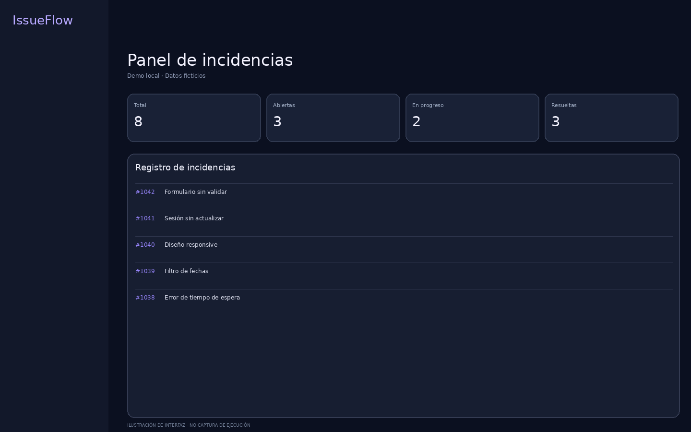
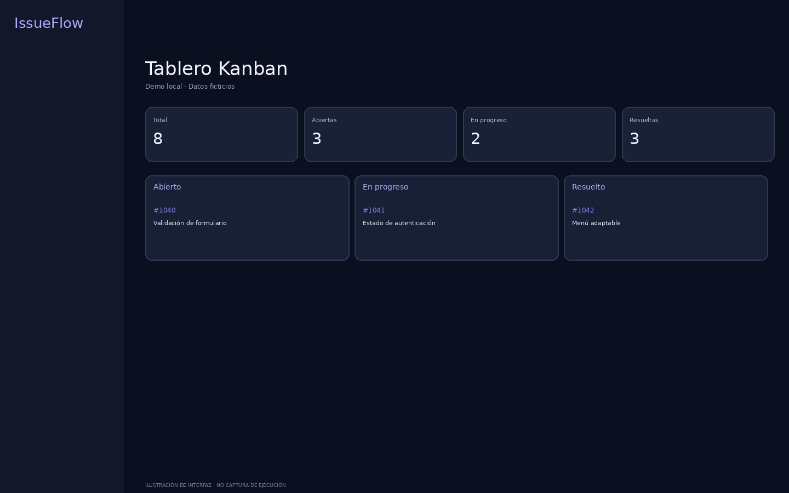
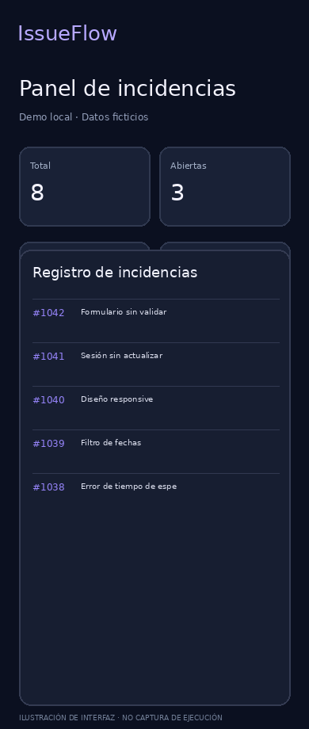

# IssueFlow — Bug Tracker & QA Dashboard

**Aplicación de demostración independiente**, diseñada para un portfolio de desarrollo web y gestión de calidad de software. Interfaz adaptable, datos ficticios y funcionamiento íntegramente local, sin cuentas ni servicios externos.

## Vista previa conceptual





Las imágenes son **ilustraciones de la interfaz previstas**, no capturas de una ejecución verificada en navegador.

## Funcionalidades

- Resumen de incidencias: total, abiertas, en progreso y resueltas.
- Alta y edición de incidencias; cambio de estado en tabla y tablero Kanban.
- Búsqueda por título, ID, descripción, responsable y área.
- Filtros de estado y prioridad, analítica visual y exportación a CSV.
- Guardado local en `localStorage` y opción para restaurar los datos ficticios.
- Responsive y sin servidor ni base de datos.

## Ejecutar

Abre `index.html` en el navegador. También puedes ejecutar un servidor local:

```bash
python -m http.server 8000
```

Después, visita http://localhost:8000. Para desplegar como GitHub Pages, publica la raíz del repositorio en Pages. La demo no envía información a ningún backend.

## Tecnologías

HTML5, CSS3, JavaScript y almacenamiento local del navegador. Esta edición autónoma es una **reimplementación de demostración** inspirada en la herramienta de seguimiento de incidencias desarrollada anteriormente, no el proyecto original completo con TanStack Start, Supabase y Playwright. No incluye autenticación real, persistencia multiusuario ni ejecución de análisis automáticos de sitios web. No se deben atribuir esas funciones a esta versión.

## Seguridad y alcance

Los nombres, incidencias y estadísticas son ficticios. No hay `.env`, claves de servicios, certificados, historial Git ni infraestructura empresarial. Los datos nuevos permanecen únicamente en tu navegador; evita introducir información real o sensible. La exportación CSV es local.

## Pruebas

La sintaxis JavaScript fue verificada con `node --check`. No se pudo ejecutar una validación funcional en Chromium debido a restricciones de navegación del entorno de preparación; se debe probar localmente antes de hacer público el repositorio.

## Autoría y uso

Proyecto de portfolio personal. No se concede licencia de reutilización de terceros por defecto. Publicar solo tras confirmar los derechos correspondientes al código y a los elementos visuales.
